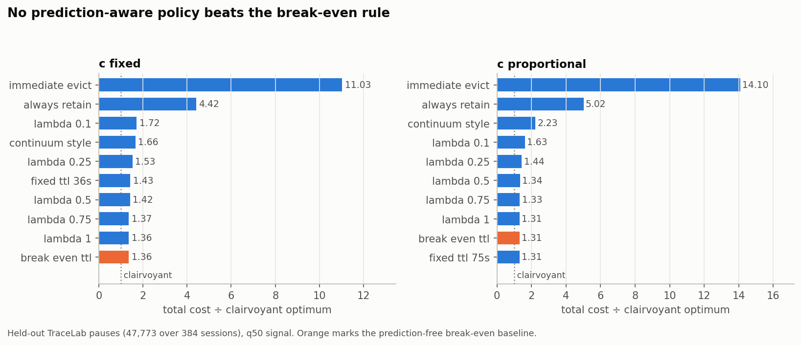

# agent-kv-retention

**Learning-Augmented KV-Cache Retention for Tool-Using LLM Agents**

How should an LLM serving system spend its GPU memory across many concurrent agent sessions that keep pausing for tool calls?

> **Status (Week 7, Oct 2026):** Weeks 3–7 complete. Pause table, validated handoff dataset, duration prediction, and now the retention policies, discrete-event simulator, offline optimum, and the full prediction-quality sweep — see **[`results/policy/REPORT.md`](results/policy/REPORT.md)**. Cost-model constants (`B`, `c`) are **not** hardware-calibrated, so absolute GPU-seconds are not meaningful; every claim is a comparison between policies under one shared model. Nothing here measures GPU KV-cache residency: pauses remain trace-derived proxies.

> **Canonical dataset:** `analysis/dataset/pause_handoff.parquet` — the Version 2 all-row categorized handoff (357,161 rows, 33 columns). Regenerate with `analysis/validation/build_pause_handoff.py`. See the [dataset guide](analysis/dataset/README.md). Do not use older filtered Parquet files.

---

## The problem

LLM inference servers hold the key-value (KV) caches of many concurrent sessions in one fixed GPU memory pool. When the pool fills, arriving requests queue.

Tool-using agents break this. An agent generates a step, pauses to run tests or search a repository, then resumes with the tool output appended to a context that may span tens of thousands of tokens. During the pause the session generates nothing, but its KV cache still occupies GPU memory.

Current engines evict a cache as soon as decoding finishes, assuming a request that stops generating is complete. For an agent that assumption is wrong on every turn, and the returning request pays a full prefill recomputation plus the queueing delay incurred behind whatever was admitted in its place.

So at each pause the system must choose how long to retain the cache, without knowing how long the pause will last:

| Choice | Benefit | Cost |
|---|---|---|
| **Retain** in GPU memory | Instant resume | Holds memory others need, for unknown duration |
| **Offload** to host memory | Frees GPU memory | PCIe transfer both ways |
| **Drop** and recompute | Frees memory immediately | Full prefill on resume, plus re-queueing |

Tool-call durations make this hard. On SWE-Bench they average 925 ms with a standard deviation of 3,550 ms; the slowest 10% of `cd` calls account for 94.1% of that tool's total delay ([Continuum, arXiv:2511.02230](https://arxiv.org/abs/2511.02230)). A few very slow calls cause almost all the waiting, so predicting the average is not good enough.

## Cost model

For a paused request retained for time `τ`, with unobserved pause duration `T`:

```
C(τ, T) = c · min(T, τ) + B · 1[T > τ]
```

- `c` — per-second opportunity cost of occupying GPU memory
- `B` — eviction penalty: recompute or reload, plus queueing on return

The prediction-free break-even retention time is `B/c`, making this structurally a ski-rental decision. Two caveats we carry: `B` scales with context length so it varies per request, and `c` depends on load. We fix `c` in the core model and study the load-dependent case in simulation.

## Research question

> How should a serving system use imperfect predictions of tool-call duration to set KV-cache retention times, so as to approach the clairvoyant optimum when predictions are accurate without falling behind prediction-free policies when they are not?

## Gap

Continuum derives its TTL properly, selecting the retention time that maximizes expected net benefit against memory-occupancy cost. But its distribution is per-tool — conditioned on nothing about the specific call — and it is always fit to the same workload it is evaluated on. No published result says what happens when the recorded distribution and the live one diverge.

Meanwhile [Choi & Joshi](https://arxiv.org/abs/2608.30830) and [ConServe](https://arxiv.org/abs/2606.01839) argue per-request prediction may be unnecessary at all. The literature disagrees and nobody has tested the disagreement directly.

**We treat prediction quality as an independent variable** and characterize the regimes where prediction-aware retention beats prediction-free retention. We measure consistency and robustness empirically; we do not claim them as theorems.

## What we build

- **Discrete-event simulator** — trace-driven, fixed KV budget, LRU eviction, serialised re-prefill *(done — `src/sim.py`; hardware calibration still outstanding)*
- **Duration predictor** — quantile regression / GBM on tool identity, argument size, context length, turn index; outputs a distribution, not a point estimate *(done, Week 4)*
- **Retention policy** — `τ = π(T̂, c, B, λ)`, where `λ` interpolates between trusting the prediction and the prediction-free break-even rule *(done — `src/policies.py`)*
- **Offline optimum** — per-pause clairvoyant oracle, the denominator of the empirical competitive ratio *(done; a true offline optimum over the coupled system is not computed)*
- **Prototype** — vLLM / SGLang with LMCache for the offload tier (stretch goal; the simulator alone answers the research question)

### Policy convention

`λ ∈ (0, 1)`, and **smaller `λ` means more trust in the prediction**:

| Prediction | Retention time `τ` |
|---|---|
| `T̂ ≥ B/c` (long pause predicted) | `λ·B/c` |
| `T̂ < B/c` (short pause predicted) | `B/(λc)` |

At `λ = 1` both rows collapse to the prediction-free break-even rule. This gives `(1+λ)`-consistency and `(1+1/λ)`-robustness (Purohit, Svitkina & Kumar, Theorem 2.2). Use this direction in the paper, the code, and the figures.

## Evaluation

Seven policies as interchangeable functions over identical traces:

1. Immediate eviction (current vLLM / SGLang behavior)
2. Always-retain
3. LRU
4. Prediction-free break-even TTL
5. Continuum-style TTL *(our reconstruction from the published description; not comparable to figures in the original paper)*
6. Ours (λ-policy)
7. Offline optimum

**Swept:** memory budget (abundant → scarce), concurrency, prediction error (clean → biased → shifted → tail-heavy → adversarial).

**Measured:** job completion time, p95/p99 latency, throughput, recomputed tokens, KV memory utilization, empirical competitive ratio.

**Success criterion.** A single `λ` that stays close to the offline optimum on clean predictions and does not fall far behind the best prediction-free policy on adversarial ones. If no such `λ` exists, that is a reportable result: it would mean the duration signal is not worth acting on for these workloads, which no prior work has tested.

## Workload

[TraceLab](https://arxiv.org/abs/2606.30560) — ~4,300 coding-agent sessions, ~350,000 LLM steps, ~430,000 tool calls from Claude Code and Codex. Supplemented with SWE-Bench (mini-swe-agent) and BFCL v4 runs.

## Results so far

### Week 3 — pause table and workload characterization

`week3/` builds `pauses.parquet`: 357,161 pauses, 351,497 usable. Start with
`week3/Week3_Trace_Processing_Report.pdf`. Version 2 corrected ~32,000 mismeasured Codex pauses
by crediting tools to the round that called them and starting newer Codex pauses at the model's
last output. Figures in `week3/figures/`.

### Week 4 — duration prediction

Session-level splits (2,920 train / 362 val / 384 test sessions), 311,764 supervised pauses.
Validation-selected model: `hgb_q50`.

| Model | Test log1p-MAE | Test MAE (s) | Threshold-flip rate @ B/c=1s |
|---|---:|---:|---:|
| global_median | 0.7530 | 16.829 | 38.2% |
| provider_tool_median | 0.6062 | 16.411 | 29.2% |
| log_ridge | 0.6556 | 16.495 | 31.4% |
| **hgb_q50** | **0.5441** | **16.196** | **26.4%** |

Session-paired bootstrap gain in log1p-MAE over the provider/tool median: **0.0621, 95% CI [0.0340, 0.0953]**.
Held-out quantile coverage P10/P50/P90 = 10.8% / 48.1% / 91.2%; central-80% interval = 80.4%.

A significant improvement in log error does **not** prove a systems-level advantage under a GPU memory
constraint. See `results/week4_extended/WEEK4_FINAL_REPORT.md` for tail, calibration, and threshold
sensitivity, and `week4/REAL_TRACE_SUMMARY.md` for provenance caveats.

### Weeks 6–7 — policy, simulator, prediction-quality sweep

Full write-up in **[`results/policy/REPORT.md`](results/policy/REPORT.md)**. Three findings:

**1. The signal is worth ~24%, and our predictor captures none of it.** The policy reads the
prediction through one bit — is `T̂ ≥ b`. With a perfect prediction λ=0.1 scores 1.036 against the
clairvoyant optimum, versus 1.360 for the prediction-free break-even rule — a 23.8% cost reduction.
With our actual q50 prediction it scores **1.717**, 26.2% *worse* than ignoring the prediction. Week 4 selected `hgb_q50` by
log1p-MAE, which is dominated by the 95% of pauses that are short; on the bit the policy needs it has
**22.3% recall**. Under-called long pauses outnumber correctly-called ones 3.5:1, so no λ can win.
Switching to the recall-oriented `q90` lifts recall to 63.9% and, under `c` proportional, λ=0.5 beats
the prediction-free baseline by 3.0% — the only configuration in the study where prediction pays.

**2. Open decision #2 is settled by measurement.** Under `c` fixed the break-even time spans **622×**
across requests (3.5s → 209s); under `c` proportional it is **75.0s for every request**, and
`fixed_ttl` is then literally the same policy as `break_even_ttl`. The choice decides whether a fixed
TTL is a weak or a strong baseline, and whether prediction helps at all.

**3. The large win is not the policy.** Immediate eviction — what vLLM and SGLang do today — is
**~6.5× worse** than any retention policy and insensitive to the memory budget. Differences *among*
retention policies are 1–2%.



## Repository layout

```
agent-kv-retention/
├── src/
│   ├── costs.py              # cost model; both c-fixed and c-proportional
│   ├── policies.py           # the seven policies as interchangeable functions
│   ├── sim.py                # discrete-event simulator, LRU, re-prefill queue
│   ├── predictor.py          # prediction loading and deliberate error injection
│   ├── evaluate.py           # per-pause scoring, decomposition, bound probes
│   └── data.py               # the one place predictions join the pause table
├── experiments/
│   ├── run_single_pause.py   # per-pause scoring + 19-condition error sweep
│   ├── run_sweeps.py         # budget × concurrency grid
│   ├── run_scarce.py         # the regime where memory actually binds
│   └── make_figures.py
├── tests/                    # policy, cost-model and simulator tests
├── analysis/
│   ├── dataset/              # pause_handoff.parquet — the canonical dataset
│   ├── trace_facts/          # exploratory tool-latency and session statistics
│   └── validation/           # pause extraction, audits, Week 3→4 handoff
├── week3/                    # pause table build, figures, trace-processing report
├── week4/                    # duration prediction pipeline, extended analysis, tests
├── results/
│   ├── week4_handoff/        # predictor metrics and calibration plots
│   ├── week4_extended/       # tail, calibration, threshold, bootstrap analyses
│   ├── policy/               # REPORT.md + policy and simulator result tables
│   └── figures/              # figures for the report and slides
├── docs/                     # progress updates
└── .github/workflows/        # CI for the Week 4 extended analysis
```

## Reproducibility

Every experiment run writes its config file and the git commit hash into its results directory. Raw data stays out of git; summary CSVs and figures are committed. Predictor train/test splits are **by session**, never by individual pause — random splits leak later turns of a session into training.

```bash
# Week 4 — duration prediction
python3 -m pip install -r week4/requirements.txt
bash week4/run_week4.sh
bash week4/run_remaining.sh

# Weeks 6–7 — policy, simulator, sweeps
python3 -m experiments.run_single_pause
python3 -m experiments.run_sweeps
python3 -m experiments.run_scarce
python3 -m experiments.make_figures

# All tests
python3 -m unittest discover -s tests -p 'test_*.py'
python3 -m unittest discover -s week4/tests -p 'test_*.py'
```

**A reproducibility caveat worth knowing.** The Week 4 pipeline is deterministic on a given machine
but not across machines: `hgb_q50` test log1p-MAE is 0.5441 as committed and 0.5450 when re-run on a
different platform. That is `HistGradientBoostingRegressor` varying with library build, not a seeding
bug. The drift is ~40× smaller than the bootstrap CI on the gain, so conclusions hold — but claims of
bit-exact reproduction from seed + SHA256 alone are too strong.

## Open decisions

1. **Offload tier.** *(open)* Our cost model is two-way (retain / evict); InferCept and Choi & Joshi
   are three-way (preserve / swap / discard). Either exclude offload explicitly and justify it, or
   extend to multi-slope ski rental. Excluding it makes current results the conservative case.
2. **Is `c` per-request?** ***(settled by measurement — both modes implemented, both reported.)***
   Under `c` fixed, `b` spans 622×; under `c` proportional, `b` is identical for every request and a
   fixed TTL becomes a strong baseline. The two modes disagree about whether prediction helps, so
   results are reported under both rather than one being assumed.
3. **`B/c` is uncalibrated.** *(open — Week 9.)* Absolute GPU-seconds are not meaningful until
   hardware measurement lands. All current claims are policy-vs-policy under one shared model.
4. **Pause-level vs request-level statistics.** *(settled.)* TraceLab's ~38 s median / ~44 min p99
   describe *complete requests*. Everything here uses pause-level numbers.

## Team

Group 9 — CSE 542 / AMS 560, Stony Brook University, Fall 2026

| Member | Owns |
|---|---|
| Hangting Lu | Formal cost model, retention policy design |
| Omkar Lashkare | Prediction, calibration, evaluation methodology |
| Brian Park | Trace processing, workload characterization |
| Zijie Shen | Simulator, baseline policies, offline optimum |
| David Mei | Hardware calibration, experiment harness, reproducibility |

## Key references

| | |
|---|---|
| Continuum / CacheTTL | [arXiv:2511.02230](https://arxiv.org/abs/2511.02230) |
| InferCept | [arXiv:2402.01869](https://arxiv.org/abs/2402.01869) |
| SAGA | [arXiv:2605.00528](https://arxiv.org/abs/2605.00528) |
| TokenCake | [arXiv:2510.18586](https://arxiv.org/abs/2510.18586) |
| Adaptive KV Retention | [arXiv:2608.30830](https://arxiv.org/abs/2608.30830) |
| ConServe | [arXiv:2606.01839](https://arxiv.org/abs/2606.01839) |
| TraceLab | [arXiv:2606.30560](https://arxiv.org/abs/2606.30560) |
| Purohit, Svitkina & Kumar | NeurIPS 2018 |
| Wei & Zhang | NeurIPS 2020 |

## License

MIT — see [LICENSE](LICENSE).
