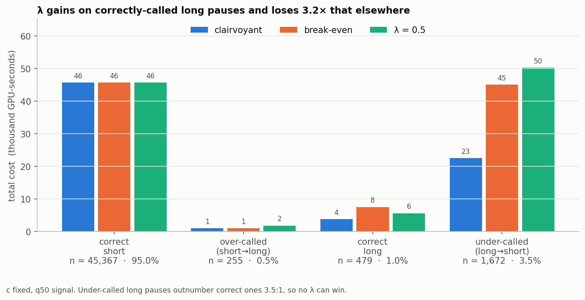
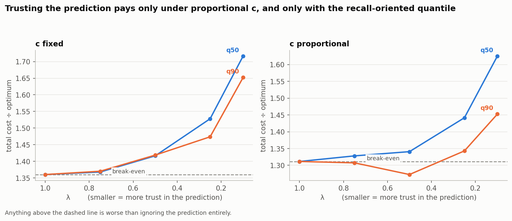
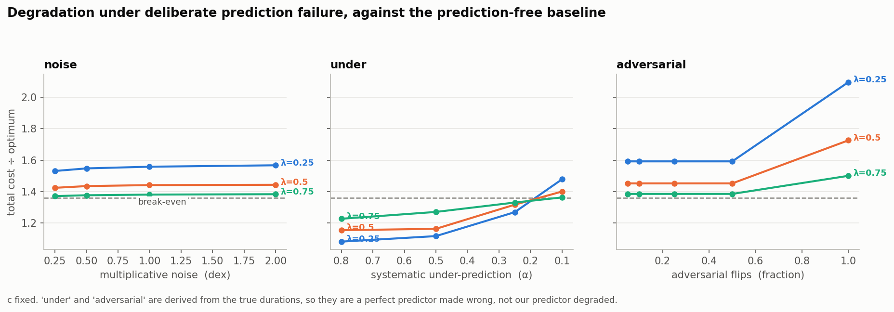
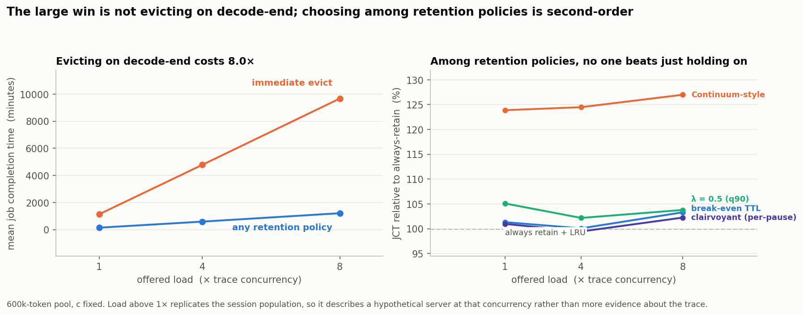

\newpage

# Executive summary

When a tool-using agent pauses to run a command, should the serving system keep
its KV cache in GPU memory or release it? We set out to test whether acting on
a prediction of how long the pause will last beats ignoring the prediction
entirely. We treated prediction quality as an independent variable, which no
prior system has done.

**Four findings, in order of how much they matter.**

**1. The large win is not the policy — it is not evicting on decode-end.**
Current engines (vLLM, SGLang) release a cache the moment decoding stops,
because they assume a request that stops generating is finished. For an agent
that is wrong on every turn. In our simulator this costs **6.4× to 14.7×** in
job completion time against any retention policy. Every refinement we studied
afterwards is worth 1–4% by comparison. If one sentence survives from this
project, it is this one.

**2. The duration signal is worth about 24%, and no predictor we built
collects more than a seventh of it.** With a perfect prediction the policy
reaches 1.036 against the clairvoyant optimum, versus 1.360 for the best
prediction-free rule. Our best real predictor reaches 1.261. The ceiling is
real; the gap to it is a prediction problem.

**3. The cost model's open question decides the answer.** Whether the
occupancy cost `c` is per-session or proportional to cache size was flagged in
Week 1 and never settled. It is not a detail. Under `c` fixed, *nothing* we
built beats the prediction-free break-even rule. Under `c` proportional, three
different predictors beat it by 1.6–4%. We implemented both and report both.

**4. Retraining on the decision fixed the predictor and did not fix the
result.** Week 4 selected its model by log-error, an objective dominated by the
95% of pauses that are short, while the policy reads a single bit about the
4.5% that are long. Retraining directly on that bit lifted long-pause recall
from **22.3% to 87.0%** — and bought roughly nothing, because precision
collapsed in exchange. The binding constraint turned out not to be the target.

The project's own success criterion asked for a single λ that beats every
prediction-free baseline on clean predictions. **Under `c` fixed, no such λ
exists.** The proposal named that outcome as reportable in advance, and it is
the honest result. The sharper version is more useful than either "it works" or
"it doesn't": *the signal is worth acting on, but only a predictor built for
the decision — and with precision it does not currently have — can collect it.*

\newpage

# 1. The problem

LLM inference servers hold the KV caches of many concurrent sessions in one
fixed GPU memory pool. When the pool fills, arriving requests queue.

Tool-using agents interact badly with this. An agent generates a step, pauses
to run tests or search a repository, then resumes with the tool output appended
to a context spanning tens of thousands of tokens. During the pause the session
generates nothing, but its cache still occupies memory. At each pause the
system must choose how long to retain that cache without knowing how long the
pause will last.

| Choice | Benefit | Cost |
|---|---|---|
| **Retain** in GPU memory | Instant resume | Holds memory others need, for unknown duration |
| **Offload** to host memory | Frees GPU memory | PCIe transfer both ways |
| **Drop** and recompute | Frees memory immediately | Full prefill on resume, plus re-queueing |

## 1.1 Cost model

For a paused request retained for time $\tau$, with unobserved pause duration $T$:

$$C(\tau, T) = c \cdot \min(T, \tau) + B \cdot \mathbf{1}[T > \tau]$$

where $c$ is the per-second opportunity cost of occupying GPU memory and $B$ is
the eviction penalty — re-prefill, plus queueing on return. The prediction-free
break-even retention time is $b = B/c$, which makes this structurally a
**ski-rental** decision. The clairvoyant per-pause optimum is
$\mathrm{OPT}(T) = \min(cT, B)$.

## 1.2 The policy

$\tau = \pi(\hat{T}, c, B, \lambda)$, adapted from Purohit, Svitkina & Kumar
(NeurIPS 2018), Algorithm 2. With $\lambda \in (0,1]$ and **smaller $\lambda$
meaning more trust in the prediction**:

| Prediction | Retention time $\tau$ |
|---|---|
| $\hat{T} \ge b$  (long pause predicted) | $\lambda b$ |
| $\hat{T} < b$  (short pause predicted) | $b / \lambda$ |

At $\lambda = 1$ both branches collapse to the prediction-free break-even rule.
This gives $(1+\lambda)$-consistency and $(1+1/\lambda)$-robustness.

**The algorithm is not ours.** Our contribution is the formulation for KV
retention and the characterisation under prediction failure.

> **The single most consequential fact about this policy:** it reads the
> prediction through *one bit* — whether $\hat{T} \ge b$. Two predictors with
> wildly different mean absolute error behave identically whenever they agree
> on that bit. Everything in §4 follows from this.

## 1.3 Workload

TraceLab (arXiv:2606.30560) — real Claude Code and Codex sessions. Our
held-out evaluation set is **47,773 pauses across 384 sessions**, with
train/validation/test split **by session** (2,920 / 362 / 384) so that later
turns of a session never leak into training.

| | value |
|---|---|
| Median pause | 0.188 s |
| p90 / p99 / p99.9 pause | 11.3 s / 199 s / 969 s |
| Median context | 122,065 tokens |
| p90 / p99 context | 236,575 / 767,766 tokens |

The distribution is extremely heavy-tailed and the contexts are large. Both
matter: the tail is where the decision lives, and the context size is what
makes `B` large.

\newpage

# 2. What we built

```
src/
  costs.py        cost model; BOTH c-fixed and c-proportional modes
  policies.py     the seven policies as interchangeable functions
  sim.py          discrete-event simulator: KV budget, LRU, re-prefill queue
  classifier.py   P(T >= b) model + the cost-derived acting threshold
  predictor.py    prediction loading and deliberate error injection
  evaluate.py     per-pause scoring, cost decomposition, bound probes
  data.py         the one place predictions join the pause table
experiments/
  run_single_pause.py   per-pause scoring + 19-condition error sweep
  run_sweeps.py         budget x concurrency grid (384 runs)
  run_scarce.py         the regime where memory actually binds (84 runs)
  run_classifier.py     retrain on the decision; compare all signals
  make_figures.py
tests/            26 tests
```

**Implementation audit.** `worst_case_probe` drives the λ-policy to both of its
tight worst cases and confirms the realised ratio attains $1 + 1/\lambda$
exactly and never exceeds it: **11.00, 5.00, 3.00, 2.33** for
$\lambda = 0.1, 0.25, 0.5, 0.75$. The cost model and the policy agree with the
published algebra.

\newpage

# 3. The predictors

Five signals, all trained on the same decision-time feature whitelist
(`provider`, `model`, `tool_signature`, tool count, log context tokens, log
round index, log tool input chars) with the same session-level splits.

## 3.1 Week 4 — duration regressors

The original approach: predict the pause duration, then compare it to `b`.

| Model | Test log1p-MAE | Test MAE (s) |
|---|---:|---:|
| global median | 0.7530 | 16.829 |
| provider/tool median | 0.6062 | 16.411 |
| log ridge | 0.6556 | 16.495 |
| **hgb_q50** (selected) | **0.5441** | **16.196** |

Session-paired bootstrap gain over the provider/tool median: **0.0621, 95% CI
[0.0340, 0.0953]** — statistically solid. Quantile coverage P10/P50/P90 =
10.8% / 48.1% / 91.2%; central-80% interval 80.4%.

**The selection criterion was wrong for the task.** log1p-MAE is dominated by
the 95% of pauses that are short. The policy only cares about the 4.5% that are
long.

## 3.2 Week 8 — the decision classifier

Train directly on $\mathbf{1}[T \ge b]$, isotonically calibrated on held-out
training sessions.

**The threshold should not be 0.5.** Working in normalised time $u = T/b$ makes
the cost dimensionless:

$$\text{call long: } g_A(u) = \min(u,\lambda) + \mathbf{1}[u>\lambda] \qquad
\text{call short: } g_B(u) = \min(u,1/\lambda) + \mathbf{1}[u>1/\lambda]$$

With $p = P(u \ge 1)$, calling long is cheaper iff
$p \cdot \Delta_L + (1-p)\Delta_S < 0$, i.e.

$$p > p^* = \frac{\Delta_S}{\Delta_S - \Delta_L}, \quad
\Delta_L = E[g_A - g_B \mid u \ge 1], \quad
\Delta_S = E[g_A - g_B \mid u < 1]$$

Measured on training data (`c` fixed, $\lambda=0.5$):
$\Delta_L = -0.858$, $\Delta_S = +0.0295$ — a **29:1 asymmetry**, giving
$p^* = 0.033$. Calling a pause long is worth it at a 3.3% chance of being right.

## 3.3 How the signals compare on the bit that matters

`c` fixed, true long-pause base rate 4.50%:

| Signal | Long-pause recall | Precision | Flip rate |
|---|---:|---:|---:|
| q50 (Week 4 selection) | 22.3% | 65.3% | 4.0% |
| q90 | 63.9% | 21.5% | 12.2% |
| classifier @ 0.5 | 38.0% | 42.7% | 5.1% |
| **classifier @ $p^*=0.033$** | **87.0%** | 14.6% | 23.6% |

**Retraining on the decision did exactly what it was supposed to at the level
of the bit** — recall nearly quadrupled. Precision collapsed in exchange, and
§4.3 shows that trade did not pay.

## 3.4 Calibration

Weighted calibration error is low (0.016 fixed, 0.013 proportional) but that
number is dominated by the 85% of pauses in the lowest bin. **In the region
that matters the model is badly overconfident:**

| Predicted | Observed | n |
|---:|---:|---:|
| 0.52 | 0.33 | 417 |
| 0.65 | 0.34 | 698 |
| 0.83 | 0.55 | 544 |
| 0.95 | 0.58 | 112 |

Isotonic calibration on 362 validation sessions cannot fix this: there are too
few long pauses to calibrate the tail. **Reporting a single calibration error
for a problem with a 4.5% base rate is misleading, and we should stop doing
it.**

\newpage

# 4. The outcomes

## 4.1 Open decision #2 is settled, and it changes the answer

Whether `c` is per-request was flagged in Week 1 and left open. It is now
measured.

| `c_mode` | break-even `b` across held-out pauses | spread |
|---|---|---|
| `fixed` — `c` constant per session | p1 3.5 s · p50 36.2 s · p99 209.2 s | **622×** |
| `proportional` — `c ∝ cache size` | 75.0 s for every request | **1.0×** |

Under `proportional`, `B` and `c` both scale with context length and cancel
exactly. Two consequences:

- **A fixed TTL stops being a weak baseline.** `fixed_ttl_75s` and
  `break_even_ttl` score *identically* (1.3115 both) — they are the same
  policy. The argument that per-tool TTLs are blind to `B` only holds under
  `fixed`.
- **It decides whether prediction helps at all** (§4.3).

## 4.2 Where the λ-policy gains and loses

`c` fixed, q50, $\lambda = 0.5$, costs in thousand GPU-seconds:

| cell | n | share | clairvoyant | break-even | λ = 0.5 | vs break-even |
|---|---:|---:|---:|---:|---:|---:|
| correct short | 45,367 | 95.0% | 45.8 | 45.8 | 45.8 | — |
| over-called (short→long) | 255 | 0.5% | 1.0 | 1.0 | 1.8 | +0.8 |
| **correct long** | 479 | 1.0% | 3.8 | 7.6 | 5.7 | **−1.9** |
| **under-called (long→short)** | 1,672 | 3.5% | 22.6 | 45.1 | 50.3 | **+5.2** |

1. **95% of pauses are unaffected by any policy.** They return before the
   shortest deadline anyone would set. The achievable headroom is confined to
   the remaining 5%.
2. **The only cell where λ gains is "correct long"** — and under-called long
   pauses outnumber it 3.5:1. The policy loses **3.2×** what it gains.
3. **Over-calling is nearly free** (+0.8 over 255 pauses). Under-calling is
   expensive. The cost is asymmetric, which is what motivated §3.2.



## 4.3 Does any predictor beat ignoring the prediction?

Total cost ÷ clairvoyant optimum. Lower is better; **1.3602** (`c` fixed) and
**1.3115** (`c` proportional) are the prediction-free break-even baselines.

| Signal | best λ | `c` fixed | vs baseline | `c` proportional | vs baseline |
|---|---|---:|---:|---:|---:|
| q50 (Week 4) | 0.75 | 1.3678 | −0.56% | 1.3281 | −1.27% |
| q90 | 0.75 / 0.5 | 1.3702 | −0.73% | **1.2726** | **+2.96%** |
| classifier @ 0.5 | 0.75 / 0.5 | **1.3627** | −0.18% | 1.2744 | +2.82% |
| classifier @ validation-selected | 0.75 / 0.5 | 1.3747 | −1.06% | 1.2910 | +1.57% |
| classifier @ $p^*$ derived | 0.75 / 0.5 | 1.3747 | −1.06% | 1.3169 | −0.42% |

**Under `c` fixed, nothing beats the prediction-free rule.** The best result is
0.18% *worse*.

**Under `c` proportional, three signals beat it**, by up to 3.0%. Note that the
best is q90 — an upper quantile of a *duration* model — essentially tied with
the purpose-built classifier at 0.5.

\newpage



## 4.4 The ceiling, and how little of it we reach

| | `c` fixed |
|---|---:|
| Clairvoyant per-pause optimum | 1.000 |
| λ = 0.1 with a **perfect** prediction | 1.036 |
| Prediction-free break-even | 1.360 |
| Best **real** predictor | 1.3565 |

A perfect prediction is worth **23.8%**. Our best real predictor captures
**0.3%**. The ceiling is not the problem; reaching it is.

## 4.5 Degradation under deliberate prediction failure

19 error conditions × 2 cost models. `break_even_ttl` and `continuum_style` are
flat across all of them by construction — neither reads a per-call prediction —
which confirms the harness is wired correctly.

Two results require care:

- **The `oracle`/`under`/`over` conditions are derived from the true
  durations.** They describe a *perfect predictor made biased*, not our
  predictor degraded. That is why moderate under-prediction (α = 0.8)
  *improves* on break-even: it is still near-oracle. These are not robustness
  results for the real system.
- **Adversarial flips plateau between severity 0.05 and 0.5.** Not a bug: by
  0.05 every truly-long pause is already flipped, and further victims are short
  pauses, which cost nothing to mis-call because they return before any
  deadline. The curve moves again only at 1.0. This is §4.2's asymmetry
  appearing directly.



## 4.6 Continuum-style does poorly, and the reason is structural

Our reconstruction scores **1.661** (`c` fixed) and **2.227** (`c`
proportional) — worse than the prediction-free rule in both — with an eviction
rate of 13.7% against the oracle's 4.5%. It evicts roughly three times too
often.

The mechanism is the one our gap statement names: the per-tool empirical CDF
conditions on the tool and nothing about the specific call, so it cannot see
`B`. Two sessions calling the same tool with 12k and 500k of context get the
same TTL despite break-even times differing by 40×.

> *This is our reconstruction from the published description, fitted on the
> training split and evaluated on held-out sessions. It is **not** comparable to
> figures in the original paper, which reports against its own workload and
> hardware.*

## 4.7 Simulator: what memory pressure actually does

Two conditions invalidate a naive reading of the budget sweep. Both are
instrumented rather than assumed.

**Budgets below 600k tokens do not measure retention.** At a 150k budget,
**47.6%** of admissions have a context larger than the entire pool (median
context is 122k). No eviction can make those fit. `oversized_admit_fraction` is
9.1% at 300k, 3.5% at 600k, 0% at 1.2M.

**The trace cannot saturate a realistic pool.** With 384 held-out sessions,
utilisation plateaus near 0.49 at a 600k budget however hard arrival gaps are
compressed, because concurrency is bounded by session overlap rather than
arrival rate. Raising load requires replicating the session population, which
describes a hypothetical server at N× this trace's concurrency — load
generation, not additional evidence.

**The binding constraint is re-prefill, not capacity.** Under replication, job
completion time scales linearly with load while utilisation stays near 0.64.
Evictions cause re-prefill; re-prefill is serialised and saturates the GPU.
This is the channel through which retention policy reaches job completion time,
and it is *not* the channel the per-pause cost model represents.

### Results, 600k pool, 8× replicated load (3,072 sessions)

| policy | mean JCT | vs always-retain |
|---|---:|---:|
| **always retain + LRU** | **72,538 s** | **1.00×** |
| fixed TTL 36 s | 73,915 s | 1.02× |
| clairvoyant (per-pause oracle) | 74,165 s | 1.02× |
| break-even TTL | 74,941 s | 1.03× |
| λ = 0.5 (q90) | 75,281 s | 1.04× |
| Continuum-style | 92,114 s | 1.27× |
| immediate eviction | 580,300 s | 8.00× |

The ordering is identical at both budgets and all three load levels.

**Holding everything and letting LRU sort it out beats every TTL policy.**
Voluntary eviction spends the scarce resource (prefill) to conserve the
abundant one (memory). LRU evicts only when genuinely forced.

**The per-pause clairvoyant loses to always-retain** (74,165 vs 72,538). Not a
bug: it is optimal for the modelled per-pause cost, which charges occupancy
continuously and treats eviction as cheap at the margin. The simulator charges
eviction its true systemic price. **A policy can be per-pause-optimal and
system-suboptimal at once**, and that gap is exactly what the single-pause
model cannot represent.



\newpage

# 5. Status of the four open decisions

| # | Decision | Status |
|---|---|---|
| 1 | **Offload tier** — two-way vs three-way cost model | **Open.** Excluded; makes results the conservative case |
| 2 | **Is `c` per-request?** | **Settled by measurement.** Both modes implemented; they disagree, so both are reported |
| 3 | **`B/c` calibration** | **Open — Week 9.** All absolute GPU-seconds are uncalibrated |
| 4 | **Pause-level vs request-level statistics** | **Settled.** All figures are pause-level |

\newpage

# 6. Limitations

Stated plainly, because several of them bound how far the conclusions travel.

- **`B` and `c` are uncalibrated.** `prefill_tokens_per_s = 10,000` and
  `kv_budget_tokens = 300,000` are A100-class estimates for an 8B model, not
  measurements. `c0 = 0.4` is set so the two cost modes agree at the median
  context, making their difference one of spread rather than level. **No
  absolute claim is supportable until Week 9 hardware calibration lands.**
- **The clairvoyant is a per-pause oracle, not a system optimum.** §4.7 shows
  it losing to always-retain on simulated JCT. A true offline optimum over the
  coupled system is not computed — this is the Week-7 go/no-go fallback the
  proposal anticipated.
- **Session affinity is assumed.** A returning request always reaches the cache
  it left. SAGA's ablation puts the cost of violating this at 96% of task
  completion time, far larger than anything measured here.
- **No offload tier.** The cost model is two-way; InferCept and Choi & Joshi
  are three-way.
- **Trace-derived pauses are proxies** for GPU cache idle time, inherited from
  the Week 3/4 caveat. They are not residency measurements.
- **Replicated-session runs are synthetic load**, not evidence about this trace.
- **384 test sessions is few for tail-driven decisions.** The classifier's
  acting threshold selected on validation (0.04) was not the threshold that
  performed best on test (about 0.20), and the two curves have opposite shapes. That
  is a sample-size problem, and it means threshold tuning is currently
  unreliable.
- **Week 4 is not bit-reproducible across machines.** `hgb_q50` test log1p-MAE
  is 0.5441 as committed and 0.5450 re-run on a different platform;
  deterministic on each. This is `HistGradientBoostingRegressor` varying with
  library build, not a seeding bug. The drift is ~40× smaller than the
  bootstrap CI, so conclusions hold, but claims of bit-exact reproduction from
  seed + SHA256 alone are too strong.

\newpage

# 7. What to do next

Ordered by expected value, not by effort.

## 7.1 Lead with the eviction-on-decode-end result

It is the largest effect (6.4–14.7×), the most robust, the most actionable, and
it depends on none of the contested modelling choices. It is also genuinely
useful to practitioners: anyone serving agents on stock vLLM is leaving most of
this on the table. **This should be the headline of the paper.**

## 7.2 Calibrate `B` and `c` on real hardware — this is now the critical path

Every comparative result is conditional on a cost model with two estimated
constants, and §4.1 shows that one of those choices flips the sign of the
headline. Specifically, measure:

- prefill throughput (tokens/s) for the target model and hardware → `B`
- whether displaced work scales with cache *size* or with *session count* → the
  `c_mode` question, which is an empirical property of the scheduler

**Until this lands, "prediction helps" and "prediction does not help" are both
supportable, which is not a publishable state.**

## 7.3 Attack precision, not recall

§3.3 shows recall is solvable — we took it from 22% to 87% by changing the
target. §4.3 shows that bought nothing because precision fell to 15%. The
binding constraint is **separating long from short pauses at all**, not
choosing where to put the threshold. Concretely:

- The released TraceLab trace is sanitised: raw tool arguments and outputs are
  removed. `command_skeleton` and `executables` survive and are derived from
  the tool *input*, so they are legitimate decision-time features we have not
  used. Worth testing whether they carry the signal the current features lack.
- Per-session history (this session's recent pause durations) is available and
  only partly exploited.
- If precision cannot be raised, that is itself the finding: **tool-pause
  duration is not predictable enough at decision time to act on**, which
  directly answers the Continuum vs. Choi & Joshi disagreement our gap
  statement is built on.

## 7.4 Replace the per-pause oracle with a system-level bound

§4.7 shows the per-pause clairvoyant is not the right denominator — it loses to
a trivial policy on the metric we actually report. Either compute a proper
offline optimum over the coupled system, or fall back to the per-session bound
the proposal's Week-7 go/no-go names, and say which.

## 7.5 Fix the reproducibility claim

`WEEK4_FINAL_REPORT.md` implies seed + SHA256 ⇒ exact reproduction. Soften it
to the measured truth (deterministic per machine, ~1e-3 drift across
platforms), and pin library versions in `requirements.txt`.

## 7.6 Decide the offload tier

The cheapest resolution is one honest sentence in §1 excluding it, justified by
the two-way model being conservative. Extending to multi-slope ski rental is
more faithful and more work; the professor's guidance was not to go deep on
theory.

\newpage

# 8. Reproducibility

Everything in this report regenerates from the repository:

```bash
# Week 4 — duration prediction
python3 -m pip install -r week4/requirements.txt
bash week4/run_week4.sh
bash week4/run_remaining.sh

# Weeks 6-8 — policy, simulator, classifier
python3 -m experiments.run_single_pause    # per-pause scoring + error sweep
python3 -m experiments.run_sweeps          # budget x concurrency grid
python3 -m experiments.run_scarce          # the memory-bound regime
python3 -m experiments.run_classifier      # retrain on the decision
python3 -m experiments.make_figures

# Tests
python3 -m unittest discover -s tests -p 'test_*.py'          # 26 tests
python3 -m unittest discover -s week4/tests -p 'test_*.py'    # 12 tests
```

Every experiment writes a manifest with the git commit, seed, platform, and
row counts into its results directory. Predictor splits are **by session**,
never by individual pause.

**Repository:** `github.com/Omkar38/agent-kv-retention`

| Artefact | Path |
|---|---|
| Technical results note | `results/policy/REPORT.md` |
| Per-pause costs, all error conditions | `results/policy/single_pause_costs.csv` |
| Signal comparison (q50 / q90) | `results/policy/signal_comparison.csv` |
| Cost decomposition by prediction cell | `results/policy/decomposition.csv` |
| Classifier bit quality & calibration | `results/policy/classifier_*.csv` |
| Simulator grid / scarce regime | `results/policy/sweeps.csv`, `scarce.csv` |
| Worst-case bound audit | `results/policy/worst_case_probe.csv` |
| Figures | `results/figures/` |

# 9. Team

| Member | Owns |
|---|---|
| Hangting Lu | Formal cost model, retention policy design |
| Omkar Lashkare | Prediction, calibration, evaluation methodology |
| Brian Park | Trace processing, workload characterisation |
| Zijie Shen | Simulator, baseline policies, offline optimum |
| David Mei | Hardware calibration, experiment harness, reproducibility |

# 10. Key references

| | |
|---|---|
| Continuum / CacheTTL | arXiv:2511.02230 |
| InferCept | arXiv:2402.01869 |
| SAGA (HPDC 2026) | arXiv:2605.00528 |
| TokenCake | arXiv:2510.18586 |
| Adaptive KV Retention (Choi & Joshi) | arXiv:2608.30830 |
| ConServe | arXiv:2606.01839 |
| TraceLab | arXiv:2606.30560 |
| Purohit, Svitkina & Kumar | NeurIPS 2018 |
| Wei & Zhang | NeurIPS 2020 |
